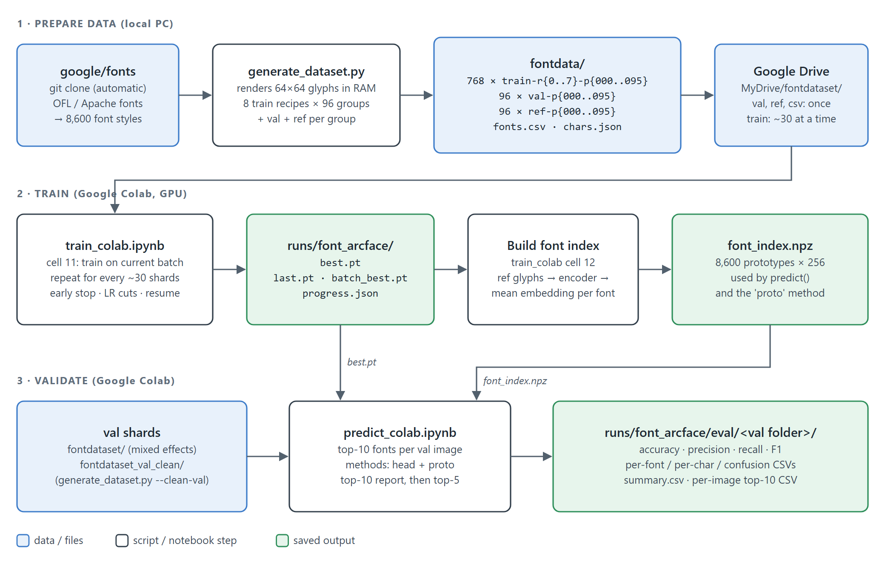
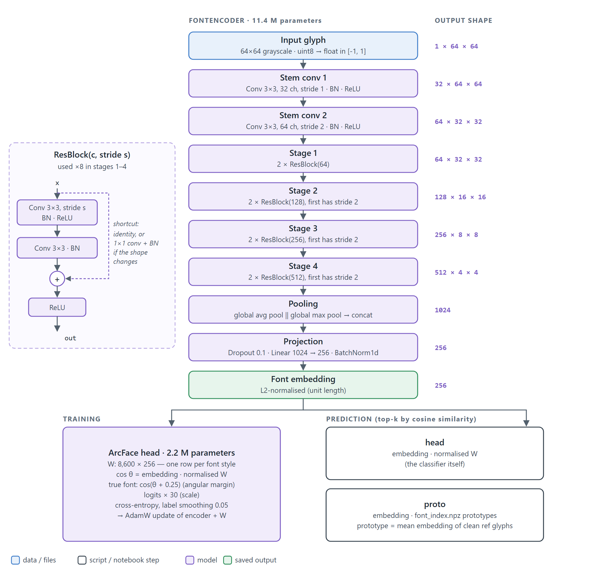
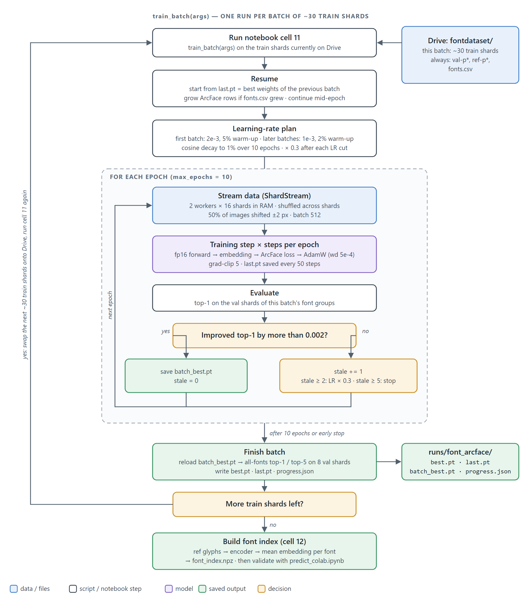

# Font Detection

Recognises which font a single glyph image is written in. The pipeline renders 8,600 Google Fonts styles into 64×64 glyph images, trains a ResNet embedding model with an ArcFace loss on Google Colab, and reports how often the correct font is in the model's top 10 and top 5 predictions.



## Contents

1. [Project files](#project-files)
2. [Requirements](#requirements)
3. [Step 1 — Generate the dataset](#step-1--generate-the-dataset)
4. [Step 2 — Generate a clean validation set (optional)](#step-2--generate-a-clean-validation-set-optional)
5. [Step 3 — Upload to Google Drive](#step-3--upload-to-google-drive)
6. [Step 4 — Train on Colab](#step-4--train-on-colab-train_colabipynb)
7. [How training works](#how-training-works)
8. [Step 5 — Build the font index](#step-5--build-the-font-index)
9. [Step 6 — Validate](#step-6--validate-predict_colabipynb)
10. [Step 7 — Predict a single image](#step-7--predict-a-single-image)
11. [Training locally with train.py](#training-locally-with-trainpy)
12. [Troubleshooting](#troubleshooting)

## Project files

| Path | What it is | Where it runs |
|---|---|---|
| `generate_dataset.py` | Renders the glyph dataset into `.npz` shards | Local PC |
| `train_colab.ipynb` | Trains the model one batch of shards at a time, builds the font index, predicts single images | Google Colab (GPU) |
| `predict_colab.ipynb` | Predicts the top 10 fonts for every validation image and writes the top-10 / top-5 accuracy, precision, recall and F1 reports | Google Colab (GPU) |
| `train.py` | Command-line version of the trainer for a local GPU/CPU | Local PC |
| ` ` | Architecture diagrams (`.svg` + `.png`) | — |
| `google-fonts/` | Clone of [google/fonts](https://github.com/google/fonts), created by `generate_dataset.py` | — |
| `fontdata/` | Generated dataset (train / val / ref shards, `fonts.csv`, `chars.json`) | — |
| `fontdata_val_clean/` | Validation shards rendered without effects (`--clean-val`) | — |
| `Files/` | Earlier experiments. Not used by this pipeline | — |

## Requirements

**Local PC (dataset generation):**

- Python 3 and Git
- Free disk space for the font repository (several GB) and the dataset (about 4.2 GB)

```bash
pip install numpy pillow fonttools
```

**Google Colab (training and validation):** a GPU runtime (Runtime → Change runtime type → GPU). PyTorch, NumPy, pandas and matplotlib are preinstalled.

**`train.py` on a local machine:** `pip install torch numpy pillow`

## Step 1 — Generate the dataset

From the project folder:

```bash
python generate_dataset.py
```

The first run clones `google/fonts` into `google-fonts/` (several GB, one time only). It then scans the fonts, writes `fontdata/fonts.csv` and renders every shard into `fontdata/`. Rendering all 960 shards took about 65 minutes on an 8-core PC, not counting the clone.

### What it produces

The 8,600 font styles are split into 96 **groups** of 90 styles (`p000`–`p095`). Each group gets:

| File | Count | Images per shard | Contents |
|---|---|---|---|
| `train-r{0..7}-p{000..095}.npz` | 768 (8 recipes × 96 groups) | ≈ 7,290 | 65 characters per font, plus a second copy of 16 high-value characters (`a g e s k y R Q G M W 2 3 7 & ?`), rendered with that recipe's effects |
| `val-p{000..095}.npz` | 96 | ≈ 1,800 | 10 characters (`a g e R Q M 2 & s k`) × 2 per font, each with the effects of 2–3 randomly picked recipes |
| `ref-p{000..095}.npz` | 96 | ≈ 5,850 | All 65 characters per font, clean. Used to build the font index |
| `fonts.csv` | 1 | — | `label_id, family, style, rel_path, instance`. The label id is the row number |
| `chars.json` | 1 | — | Character list. A shard's `char` value is an index into it |

Each `.npz` shard contains:

| Key | Shape / type | Meaning |
|---|---|---|
| `x` | `(N, 64, 64) uint8` | Grayscale glyph images |
| `font` | `(N,) int16` | Font style label (row in `fonts.csv`) |
| `char` | `(N,) uint8` | Character index (into `chars.json`) |
| `family` | `(N,) int16` | Font family index |
| `meta` | JSON string | Kind, group, image count, recipe |

### Train recipes

| Recipe | Name | Effects |
|---|---|---|
| `r0` | clean | ±1 px shift only |
| `r1` | invert_contrast | 60% white-on-black, small rotation, light blur |
| `r2` | light_real | inversion, rotation ±5°, scale, blur, noise, contrast |
| `r3` | photo | perspective, shear, motion blur, noise, contrast |
| `r4` | screenshot | low resolution, JPEG artefacts |
| `r5` | design | inversion, outline, drop shadow |
| `r6` | segmentation | slivers of neighbouring letters, crop jitter, blobs, underline, blur |
| `r7` | mixed | random combination of 2–3 of recipes 1–6 per image |

### Options

| Option | Default | Meaning |
|---|---|---|
| `--fonts DIR` | `google-fonts/` | google/fonts checkout (cloned automatically if missing) |
| `--out DIR` | `fontdata/` | Output folder for shards |
| `--shards N [N ...]` | `0 1 2 3 4 5 6 7` | Train recipes to build. `--shards` with no numbers builds no train shards |
| `--workers N` | CPU cores − 1 | Rendering processes |
| `--no-val` | off | Skip val shards |
| `--no-ref` | off | Skip ref shards |
| `--clean-val` | off | Render val shards with the clean recipe (see Step 2) |
| `--labels PATH` | — | Reuse an existing `fonts.csv` (and the `chars.json` next to it) when `--out` is a new folder |

```bash
python generate_dataset.py --shards 0 1 --workers 6      # only recipes r0 and r1 (+ val + ref)
python generate_dataset.py --shards --no-ref             # only val shards
python generate_dataset.py --fonts D:\google-fonts --out D:\fontdata
```

### Things to know

- **Re-running is safe.** Shards that already exist are skipped. Each shard is written to a temp file, checked and then renamed, so an interrupted run never leaves a broken shard. To rebuild a shard, delete it and run again.
- **Keep `fonts.csv` fixed.** The label ids of every shard and every checkpoint depend on it. If `fonts.csv` exists in `--out`, it is reused. When writing to a new folder, pass `--labels fontdata/fonts.csv` so the ids stay identical.
- Fonts are skipped if they are missing more than 10% of the characters or are larger than 15 MB (mostly CJK and emoji fonts). Variable fonts are expanded into one style per named instance.

## Step 2 — Generate a clean validation set (optional)

The standard val shards use random blur, noise, rotation, inversion, low resolution and other effects. To measure the model on sharp, black-on-white glyphs, render a second val set with the clean recipe:

```bash
python generate_dataset.py --shards --no-ref --clean-val --labels fontdata/fonts.csv --out fontdata_val_clean
```

This writes `fontdata_val_clean/val-p000.npz` … `val-p095.npz` (≈ 171,900 images, 52 MB) plus copies of `fonts.csv` and `chars.json`. The same fonts and characters are used as in the standard val set; only the effects are removed. The shard `meta` says `"recipe": "val-clean"`.

Keep the original `fontdata/val-p*.npz` for training: `train_colab.ipynb` uses them for early stopping.

## Step 3 — Upload to Google Drive

Both notebooks expect this layout (paths can be changed in their Settings cells):

```text
MyDrive/
├── fontdataset/                       ← train_colab: args.data
│   ├── fonts.csv
│   ├── chars.json
│   ├── val-p000.npz … val-p095.npz    ← upload once, keep
│   ├── ref-p000.npz … ref-p095.npz    ← upload once, keep
│   └── train-r*-p*.npz                ← only the current batch (~30 files)
├── fontdataset_val_clean/             ← predict_colab: args.val_dir (optional)
│   ├── fonts.csv · chars.json
│   └── val-p000.npz … val-p095.npz
└── FontDetection/runs/font_arcface/   ← args.out, created by training
```

Upload `fonts.csv`, `chars.json`, all `val-p*.npz` and all `ref-p*.npz` once. Train shards go up about 30 at a time (Step 4).

## Step 4 — Train on Colab (`train_colab.ipynb`)

1. Upload `train_colab.ipynb` to Colab and select a GPU runtime.
2. Copy the first batch of about 30 `train-r*-p*.npz` files into `MyDrive/fontdataset/`.
3. Run all cells. Cell numbers in this README are the notebook's numbered section headings. Cell 3 (Settings) prints how many train, val and ref shards it found.
4. Cell 11 (**Train on current batch**) trains on the train shards currently in the folder. It ends with:

   ```text
   batch finished in <minutes>m: best batch-val top1 <…>, all-fonts top1 <…> top5 <…>
   <done>/768 shards trained. Replace the train shards with the next batch and run this cell again.
   ```

5. Delete the batch's train shards from Drive, copy in the next ~30 and run cell 11 again. Repeat until all 768 are trained. Cell 10 (**Status**) shows the progress of every finished batch.
6. Run cell 12 (**Build font index**) after the last batch (Step 5).

**Choosing batches.** Shards are named `train-r<recipe>-p<group>`. Any set of files works. The early-stopping check uses the val shards of the groups (`p…`) present in the batch. Example of one batch: every recipe for four groups, `train-r{0..7}-p{000..003}` (32 files). Watch the *all-fonts top1* number at the end of each batch: it covers fonts from every group, so a drop there means the model is forgetting fonts from earlier batches.

### Settings (cell 3)

| Setting | Default | Meaning |
|---|---|---|
| `data` | `/content/drive/MyDrive/fontdataset` | Folder with shards, `fonts.csv` |
| `out` | `/content/drive/MyDrive/FontDetection/runs/font_arcface` | Checkpoints and `progress.json` |
| `total_files` | 768 | Train shards in the full dataset (for the progress display) |
| `max_epochs` | 10 | Maximum epochs per batch; the cosine LR schedule spans this |
| `patience` | 5 | Early stop after this many epochs without improvement |
| `lr_patience` | 2 | Cut the LR after this many epochs without improvement |
| `lr_factor` | 0.3 | LR multiplier per cut |
| `min_delta` | 0.002 | Smallest val top-1 gain that counts as an improvement |
| `lr` / `warmup` | 2e-3 / 5% | Starting LR and warm-up for the first batch |
| `lr_later` / `warmup_later` | 1e-3 / 2% | Starting LR and warm-up for later batches |
| `min_lr_frac` | 0.01 | LR decays to `lr × 0.01` by the end of `max_epochs` |
| `batch` | 512 | Images per step |
| `wd` | 5e-4 | AdamW weight decay |
| `emb_dim` / `width` | 256 / 64 | Embedding size / base CNN width. Must stay the same for one `out` folder |
| `margin` / `scale` | 0.25 / 30 | ArcFace angular margin / logit scale |
| `workers` / `buffer_files` | 2 / 16 | Data-loading processes / shards held in RAM per process |
| `eval_files` | 8 | Val shards used for the all-fonts score at the end of a batch |
| `log_every` / `ckpt_every` | 5 / 50 | Log line / `last.pt` save interval in steps |

### Outputs in `out`

| File | Written | Contents |
|---|---|---|
| `last.pt` | Every 50 steps, every epoch, end of batch | Model, ArcFace head, optimizer and position. Used to resume and to start the next batch |
| `batch_best.pt` | When val top-1 improves | Best weights of the current batch |
| `best.pt` | End of every batch | Best weights of the latest batch. Used by the index, prediction and validation |
| `progress.json` | Every epoch | Finished batches with their scores, plus the state of the current batch |
| `font_index.npz` | Cell 12 | Font prototypes (Step 5) |

**Resuming.** If Colab disconnects, reconnect, run the cells again and run cell 11. It continues the same batch from the last saved step. Running cell 11 again on a batch that has already finished trains it again, starting from its best weights.

**Starting over.** Use a new `out` folder, or delete `last.pt`, `batch_best.pt`, `best.pt` and `progress.json` from the old one.

## How training works

### Model



- **FontEncoder** (11.4 M parameters) is a small ResNet. The 64×64 glyph passes through a two-convolution stem and four stages of two residual blocks each (64 → 128 → 256 → 512 channels, down to 4×4). Global average and max pooling are concatenated (1,024 values). A linear layer with BatchNorm projects that to a 256-number embedding, which is L2-normalised.
- **ArcFace head** (2.2 M parameters) holds one 256-number weight row per font style. The cosine between the embedding and each row is the font's score. During training, an angular margin of 0.25 is added to the true font's angle and the scores are multiplied by 30 before cross-entropy (label smoothing 0.05). This pulls the glyphs of one font into a tight cluster and pushes different fonts apart.
- **Prediction** ranks fonts by cosine similarity with either the ArcFace rows (`head`) or the font prototypes in `font_index.npz` (`proto`).

### Training loop (`train_batch`)



1. **Resume.** Loads `progress.json` and starts from `last.pt`, which holds the best weights of the previous batch. If `fonts.csv` gained fonts, the ArcFace head gets new rows. An interrupted batch continues from its last saved step.
2. **Learning rate.** The first batch starts at 2e-3 with a 5% warm-up; later batches start at 1e-3 with a 2% warm-up, to forget less. The LR follows a cosine curve down to 1% over `max_epochs` and is multiplied by 0.3 after each LR cut.
3. **Each epoch.**
   - `ShardStream` streams images from the batch's shards. Each of 2 workers holds 16 shards in RAM and samples randomly across them, so one step mixes fonts, groups and recipes. Half of the images get a random ±2 px shift.
   - Each step runs the encoder in fp16, computes the ArcFace loss and updates the encoder and head with AdamW (gradient clipping at 5). `last.pt` is saved every 50 steps.
   - After the epoch, top-1 accuracy is measured on the val shards of the batch's font groups. An improvement of more than 0.002 saves `batch_best.pt`. Two epochs without improvement cut the LR by 0.3; five stop the batch early.
4. **Finish.** Reloads `batch_best.pt`, measures top-1 / top-5 on 8 val shards spread across all fonts, and writes `best.pt`, `last.pt` and `progress.json`.

## Step 5 — Build the font index

Run cell 12 (**Build font index**) in `train_colab.ipynb` after training, and again every time `best.pt` changes. It embeds every glyph in `ref-p*.npz` with `best.pt`, averages the embeddings per font and writes `out/font_index.npz`:

| Key | Contents |
|---|---|
| `prototypes` | `(8600, 256)` normalised mean embedding per font |
| `valid` | Fonts that had reference images |
| `family`, `style` | Font names |

## Step 6 — Validate (`predict_colab.ipynb`)

1. Upload `predict_colab.ipynb` to Colab and select a GPU runtime.
2. In cell 3 (Settings), set `val_dir`:
   - `'/content/drive/MyDrive/fontdataset_val_clean'` (default) tests the clean val set from Step 2.
   - `None` tests the standard val shards in `data`.
3. Run all cells.

| Cell | What it does |
|---|---|
| 9 Run predictions | Predicts the top 10 fonts for every image in every val shard, printing the running top-1 / top-5 / top-10 per shard |
| 10 Examples | Prints random images with their top-10 list and marks the correct font |
| 11 Top-10 report | Accuracy, precision, recall, F1 and breakdowns when the correct font must be in the top 10 |
| 12 Top-5 report | The same with the top 5 |
| 13 Summary | One table comparing top-10 and top-5 for each method |
| 14 Look at misses | Grid of images whose correct font is not in the top 5 |

### Settings

| Setting | Default | Meaning |
|---|---|---|
| `data` | `…/fontdataset` | `fonts.csv`, `chars.json` |
| `out` | `…/runs/font_arcface` | `best.pt` and `font_index.npz` |
| `val_dir` | `…/fontdataset_val_clean` | Folder with the `val-p*.npz` to test (`None` = `data`) |
| `ckpt` | `best.pt` | Checkpoint (falls back to `last.pt`) |
| `methods` | `['head', 'proto']` | `head` = ArcFace classifier, `proto` = `font_index.npz`. `proto` is skipped if the index does not exist |
| `kmax` | 10 | Fonts kept per image |
| `val_limit` | `None` | Test only the first N val shards |
| `reuse` | `True` | Reuse saved predictions when the checkpoint and val folder have not changed |
| `show_examples` / `worst` | 10 / 15 | Example images / rows in the worst-font tables |
| `save_per_image` | `True` | Write the per-image CSV |

### head vs proto

- **`head`** scores each font with its ArcFace weight row. It matches the accuracy printed during training. Fonts from groups that have not been trained yet have near-random rows.
- **`proto`** scores each font with its prototype in `font_index.npz`, the same way `predict()` works. This is the number that matters for real use. Rebuild the index after every new `best.pt`; the notebook warns when the index is older than the checkpoint.
- On the clean val set, `proto` is optimistic: clean val glyphs look almost the same as the clean ref glyphs the prototypes are built from. `head` is the fairer measure there.

### Metrics

For top-**k**, an image is **correct** when the true font is anywhere in its top-k list. Its predicted label is then the true font; otherwise it is the top-1 font. Per-font precision, recall and F1 are computed on those labels.

| Metric | Meaning |
|---|---|
| top-k accuracy | Share of images whose true font is in the top k |
| top-1 accuracy | Share of images whose true font is ranked first |
| family accuracy | A font of the correct family is in the top k (the style may be wrong) |
| recall (per font) | Share of that font's images whose top-k contains it |
| precision (per font) | Of the images labelled as that font, the share that really are it |
| macro / weighted / micro | Plain average over fonts / weighted by image count / over all images (micro = top-k accuracy) |
| MRR@k | Mean of 1 / rank of the true font (0 when outside the top k) |
| mean / median rank | Rank of the true font among all 8,600 fonts |
| fonts always / never correct, below 50% | Fonts whose recall is 100% / 0% / under 50% |

### Outputs

Written to `out/eval/<val folder name>/`, so the clean and standard val results are kept apart:

| File | Contents |
|---|---|
| `report_<method>_top10.json`, `report_<method>_top5.json` | All metrics above |
| `per_font_<method>_top<k>.csv` | Images, correct, recall, precision, F1 and the font it is most often confused with, per font |
| `per_char_<method>_top<k>.csv` | Accuracy per character |
| `confusions_<method>_top<k>.csv` | Most frequent (true font → top-1 prediction) mistakes |
| `per_image_<method>.csv` | Every val image: shard, index, character, true font, rank, in top 5, in top 10, top-10 fonts with scores |
| `summary.csv` | Top-10 vs top-5 for each method |
| `predictions.npz` | Raw predictions, reused by the next run |

## Step 7 — Predict a single image

In `train_colab.ipynb`, run cell 13 (**Predict**) and upload one or more images. Each image should be a tight crop of one character. It is converted to grayscale, resized and padded to 64×64, and matched against `font_index.npz`. The output is the top 5 fonts with their cosine similarity:

```text
1. <family> <style>  (<similarity>)
...
5. <family> <style>  (<similarity>)
```

## Training locally with `train.py`

`train.py` is the command-line trainer for a local GPU or CPU. It reads `fontdata/` and writes `runs/font_arcface/` by default. It trains in chunks of `--files` shards and plans `--passes` full passes over all train shards. Its `progress.json` has a different format from the notebook's, so don't use the same `--out` folder for both.

```bash
python train.py --files 24          # train on the next 24 shards, then stop
python train.py --files 24          # run again: continues with the next 24
python train.py --status            # how far training has got
python train.py --build-index       # build font_index.npz (needed for --predict)
python train.py --predict crop.png  # top-5 fonts for one glyph
python train.py --incremental --total-files 768   # train on whatever train shards are in --data
```

Run `python train.py --help` for all options (`--passes`, `--patience`, `--proto-eval`, `--lr`, `--batch`, …).

## Troubleshooting

| Message / problem | Fix |
|---|---|
| `last.pt was trained with emb_dim=…, width=…` | `emb_dim` and `width` must match the checkpoint. Restore them, or use a new `out` folder |
| `no train shards found` | No `train-r*-p*.npz` in `args.data`. Copy the next batch in |
| `note: N of these shards were trained in an earlier batch` | Informational. The batch repeats shards that were already used |
| `expanded ArcFace head: A → B classes` | `fonts.csv` gained fonts. The new rows start random |
| `font_index.npz not found … skipping proto` | Run cell 12 in `train_colab.ipynb` |
| `warning: font_index.npz is older than the checkpoint` | Rebuild the index (cell 12) so `proto` uses the current model |
| Labels look wrong after regenerating data | `fonts.csv` changed. Regenerate with `--labels` pointing at the original `fonts.csv` |
| Colab runs out of RAM | Lower `buffer_files` or `workers` in Settings |
